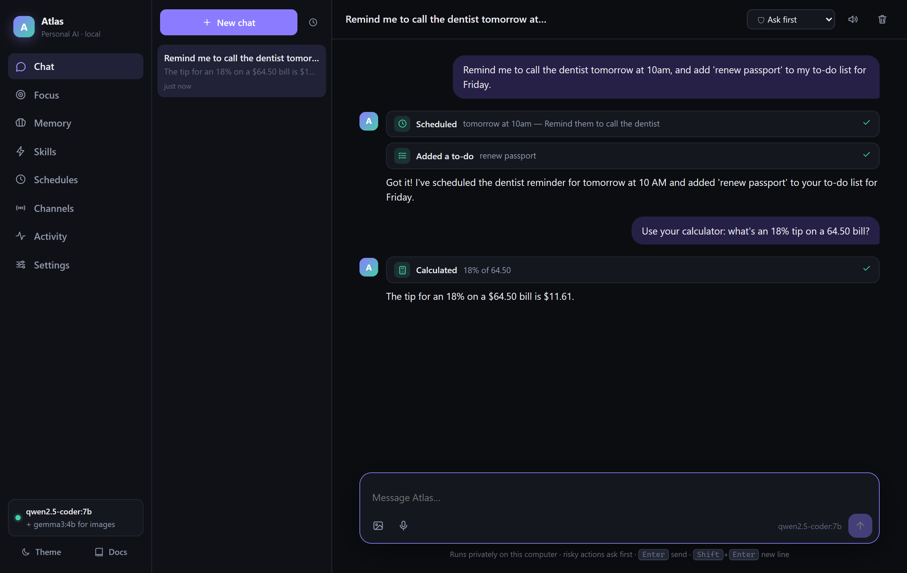
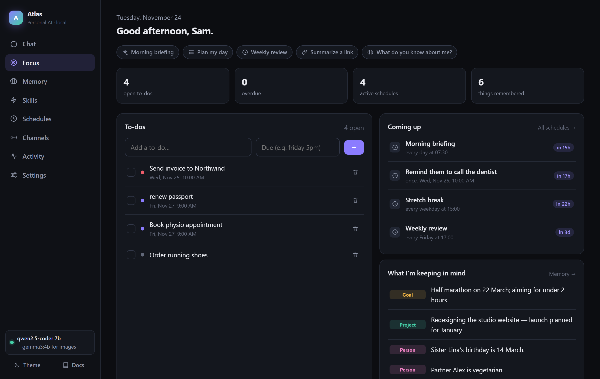
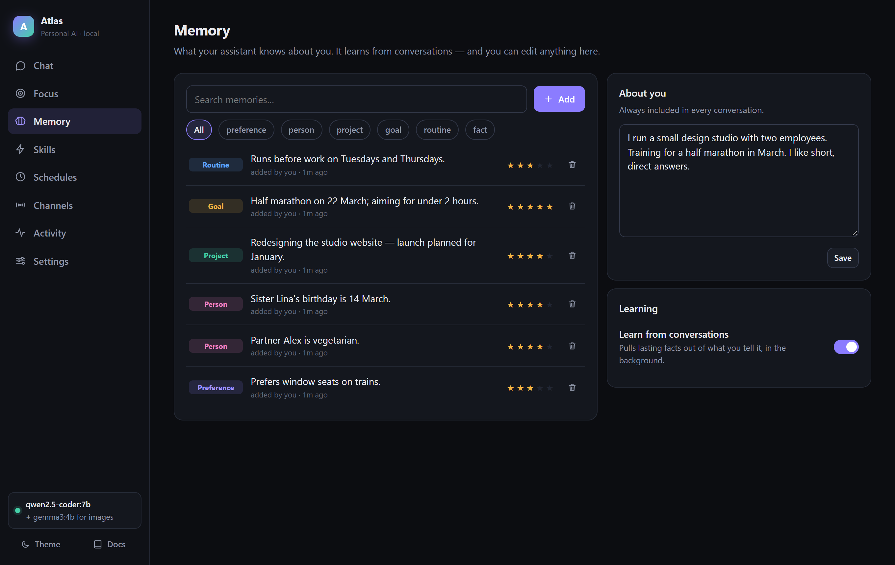
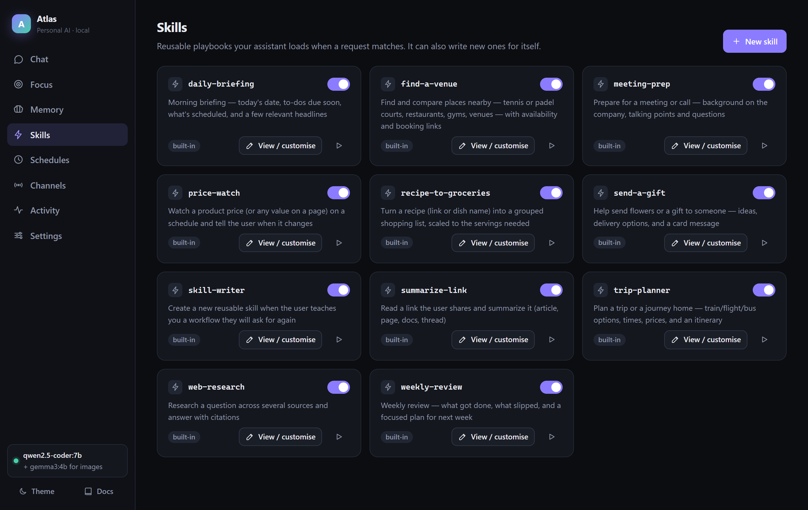
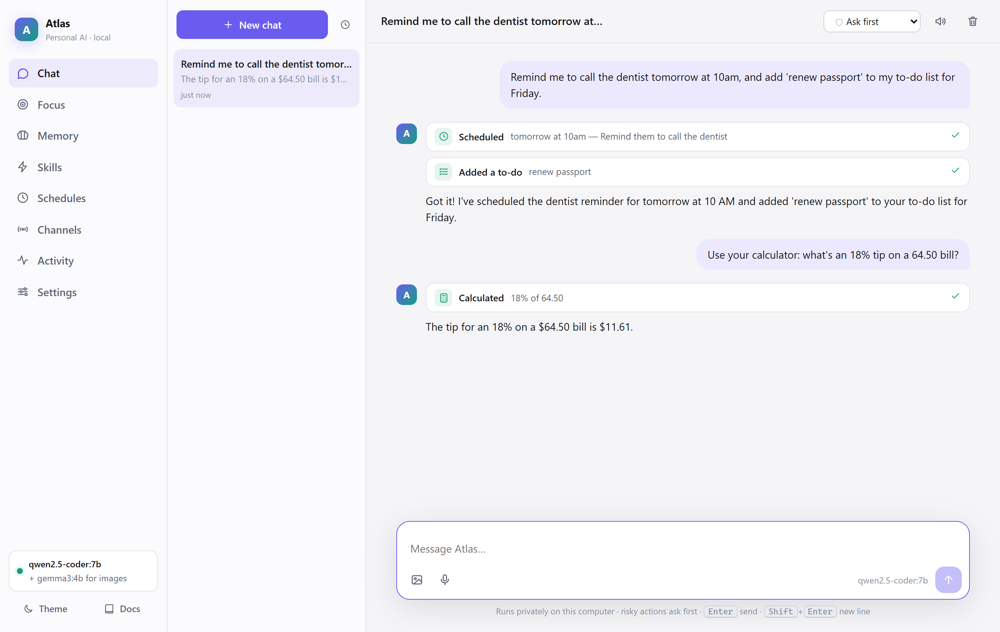
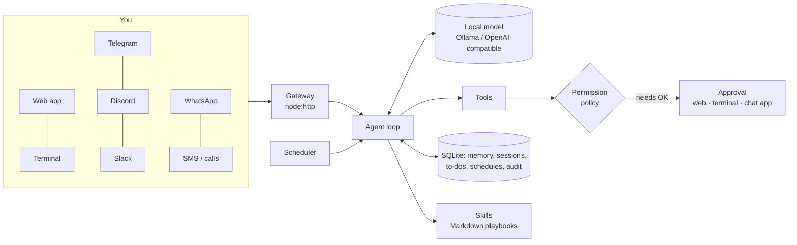

# Personal AI Assistant

**An open-source AI assistant that lives on your own computer.** Talk to it from a web app, your terminal, Telegram, Discord, Slack, WhatsApp, a text message or a phone call. It remembers what matters to you, reminds you of things, runs recurring tasks, researches the web, drives a real browser and works with your files — and asks before it does anything risky.

Runs on local models through [Ollama](https://ollama.com) (or any OpenAI-compatible server), so your conversations never leave your machine. **Zero npm dependencies** — just Node.js.

  



<table>
  <tr>
    <td></td>
    <td></td>
  </tr>
  <tr>
    <td align="center"><b>Focus</b> — to-dos, what's coming up, what it keeps in mind</td>
    <td align="center"><b>Memory</b> — everything it knows about you, editable</td>
  </tr>
  <tr>
    <td></td>
    <td></td>
  </tr>
  <tr>
    <td align="center"><b>Skills</b> — Markdown playbooks it loads on demand</td>
    <td align="center">Light theme</td>
  </tr>
</table>

---

## What it does

- **Chat anywhere** — a polished web app with streaming replies, plus the terminal, Telegram, Discord, Slack, WhatsApp, SMS and voice calls. One assistant, one memory, every channel.
- **Remembers you** — long-term memory it builds as you talk ("prefers aisle seats", "sister Lina's birthday is 14 March"), plus an *About you* profile. Everything is visible and editable.
- **Proactive** — reminders, recurring jobs and a morning briefing, delivered wherever you are. Scheduled jobs can stay silent when there's nothing worth saying.
- **Does things** — web search and reading, a real Chrome/Edge browser it can click and type in, files, terminal commands, HTTP APIs, to-dos, a calculator.
- **Sees images** — send a photo or screenshot; a local vision model describes it for the assistant.
- **Safe by design** — three permission modes, approvals you can answer from the web app, the terminal or right inside the chat app, pairing codes for every new contact, hard blocks on destructive commands, and a complete audit log.
- **Extensible** — skills are plain Markdown playbooks. It ships with 11, and it can write new ones for itself.

## Quick start

```bash
# 1. Install Ollama (https://ollama.com) and a model with tool support
ollama pull qwen3:8b          # or llama3.2:3b on smaller machines
ollama pull gemma3:4b         # optional: lets it see images

# 2. Get the assistant and start it (Node.js 22.5+; nothing to npm install)
git clone https://github.com/rana537omar/personal-ai-assistant.git
cd personal-ai-assistant
npm start
```

Open **http://localhost:6100**. A short setup asks what to call your assistant, a little about you, which model to use and how much freedom to give it.

```bash
npm run chat       # chat from the terminal
npm run doctor     # check Node, Ollama, models and browser
npm test           # run the test suite
```

## Talk to it from anywhere

| Channel | How it connects | Needs a public URL? |
|---|---|---|
| **Web app** | Built in, at `localhost:6100` | No |
| **Terminal** | `npm run chat` / `assistant chat` | No |
| **Telegram** | Bot API, long polling | No |
| **Discord** | Gateway WebSocket (DMs and @mentions) | No |
| **Slack** | Socket Mode (DMs and @mentions) | No |
| **WhatsApp** | WhatsApp Business Cloud API webhook | Yes (tunnel) |
| **SMS & phone calls** | Twilio webhooks — text it or call it and talk | Yes (tunnel) |
| **HTTP API** | `POST /api/v1/message` with a bearer token | Only for remote use |

Set each one up under **Channels** in the web app; step-by-step instructions are in [docs/channels.md](docs/channels.md). Every new person who messages the bot gets a **pairing code** — nothing happens until you approve them.

## How it works



- **Agent loop** (`src/agent.js`) — builds a compact system prompt (persona, your profile, relevant memories, open to-dos, skill index), streams the model's reply, executes tool calls, and loops until it has an answer. It works with native tool calling *and* with models that write tool calls as text, and it double-checks small models that *claim* to have done something without calling the tool.
- **Tools** (`src/tools/`) — each declares a risk level; the policy decides whether it runs, asks you, or is refused.
- **Memory** (`src/memory.js`) — SQLite FTS5 search over facts; a background pass extracts lasting facts from what you say, only when the GPU is idle.
- **Scheduler** (`src/scheduler.js`) — cron, intervals and one-off times parsed from plain English ("every weekday at 8:30", "in 20 minutes").
- **Channels** (`src/channels/`) — each adapter turns platform messages into turns, with pairing, slash commands and approvals.

## Tools

| Tool | What it does | Risk |
|---|---|---|
| `remember` · `recall` · `forget` | Long-term memory | safe |
| `todo_add` · `todo_list` · `todo_done` | To-do list | safe |
| `schedule_task` · `list_scheduled` · `cancel_scheduled` | Reminders and recurring jobs | safe |
| `calculate` · `current_time` | Exact maths, the time | safe |
| `web_search` · `web_fetch` | Search (DuckDuckGo or your SearXNG) and read pages | read |
| `browser` | Open, read, click, type, scroll, screenshot in a real browser | read / **external** for click & type |
| `read_file` · `list_files` · `search_files` | Files in the workspace (outside it: asks) | read / sensitive |
| `write_file` | Write files in the workspace (outside it: asks) | workspace / write |
| `run_command` | PowerShell or shell command (allowlisted ones run directly) | **exec** |
| `http_request` | Call APIs — GET runs, other methods ask | read / external |
| `send_message` | Message *you* on a connected app | safe |
| `use_skill` · `create_skill` | Load a skill / write a new one | safe / write |

## Permission modes

| | Ask first *(default)* | Auto | Read-only |
|---|---|---|---|
| Memory, to-dos, schedules, web reading | ✅ | ✅ | ✅ |
| Write files in the workspace | ✅ | ✅ | ❌ |
| Read files outside the workspace | asks | ✅ | asks |
| Shell commands, browser clicks/typing, POST requests, writing outside the workspace | asks | ✅ | ❌ |

Always on, in every mode: destructive commands (wiping disks, formatting, `rm -rf /`, shutdown…) are blocked; the browser never types into password fields; fetched pages are labelled as untrusted data; and every tool call is logged under **Activity**. See [SECURITY.md](SECURITY.md).

## Skills

A skill is a folder with a `SKILL.md`:

```markdown
---
name: recipe-to-groceries
description: Turn a recipe (link or dish name) into a grouped shopping list
---

1. Get the recipe: `web_fetch` the link, or `web_search` for "<dish> recipe".
2. Check memory (`recall` "diet allergies household").
3. Output a shopping list grouped by aisle…
```

The assistant sees each skill's name and description and loads the full instructions with `use_skill` when a request matches. Bundled: `daily-briefing`, `web-research`, `summarize-link`, `trip-planner`, `recipe-to-groceries`, `send-a-gift`, `find-a-venue`, `weekly-review`, `meeting-prep`, `price-watch`, `skill-writer`. Your own skills live in `data/skills/` and override bundled ones with the same name. More in [docs/skills.md](docs/skills.md).

## Models

Any Ollama model works; models with **tool support** work best. Good picks:

| Model | Notes |
|---|---|
| `qwen3:8b` | Best all-rounder with tools, ~6 GB VRAM |
| `llama3.2:3b` | Small and fast, ~3 GB |
| `gpt-oss:20b` | Strongest reasoning, 16 GB+ |
| `gemma3:4b` | Vision — reads photos and screenshots |

Prefer LM Studio, llama.cpp, vLLM or LocalAI? Choose **OpenAI-compatible server** in Settings → Model and point it at your server's `/v1` URL.

## Configuration

Most settings live in the web app (Settings) and are stored in SQLite. Environment variables:

| Variable | Default | |
|---|---|---|
| `PORT` | `6100` | Web app / API port |
| `HOST` | `127.0.0.1` | Set `0.0.0.0` to listen on your network (remote visitors need the access token) |
| `OLLAMA_URL` | `http://127.0.0.1:11434` | Initial Ollama address |
| `ASSISTANT_DATA` | `./data` | Where the database, custom skills and browser profile live |
| `ASSISTANT_URL`, `ASSISTANT_TOKEN` | — | Point the CLI at a gateway on another machine |

Your data is one SQLite file (`data/assistant.db`) plus `data/skills/` and the workspace folder. Back up `data/` to keep everything; **Settings → Data → Export** gives you JSON.

## CLI

```
assistant start               Start the gateway
assistant chat [--session ID] Chat in the terminal (approvals are asked inline)
assistant send "message"      One message, print the reply
assistant status              Model, permission mode, channels, pending approvals
assistant doctor              Check your setup
```

Install globally with `npm link` to get the `assistant` command, or use `node bin/assistant.js …`.

## Project layout

```
bin/assistant.js        CLI
src/server.js           HTTP gateway: web app, REST API, event stream, webhooks
src/agent.js            Agent loop, system prompt, history, streaming
src/llm.js              Ollama + OpenAI-compatible providers
src/tools/              Tool implementations and the permission policy
src/channels/           Telegram, Discord, Slack, WhatsApp, Twilio adapters + pairing
src/memory.js           Long-term memory (SQLite FTS5) and auto-extraction
src/scheduler.js        Runs due jobs; src/jobs.js stores them
src/skills.js           Skill loader
src/util/               Natural-language scheduling, calculator, HTML→text, sandbox
public/                 Web app (vanilla JS modules, no build step)
skills/                 Bundled skills
test/                   node:test suites
```

## Roadmap

- Email (IMAP/SMTP) and calendar (CalDAV) tools
- Signal and Matrix channels
- Local speech-to-text for voice notes (whisper.cpp)
- Embedding-based memory search alongside FTS
- MCP server support for third-party tools
- Multi-user mode with per-person memory

## Contributing

Issues and pull requests are welcome — see [CONTRIBUTING.md](CONTRIBUTING.md). Please report security problems privately as described in [SECURITY.md](SECURITY.md).

## License

[MIT](LICENSE)
